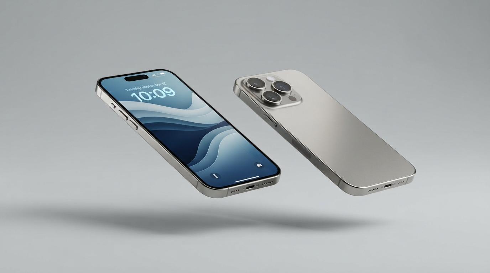

# NovaPhone — Apple-Inspired iPhone Showcase & Buyer's Guide

An Apple-inspired product showcase and independent buyer's guide for the iPhone 16 lineup, built with modern web technologies, Cupertino design principles, and responsive interactive elements.



## Features

- **Cupertino Design System**: Precision-engineered typography (Inter), subtle glassmorphism navigation, neutral background canvases, and high-fidelity product imagery.
- **Interactive Lineup Explorer**: Filter dynamically between all models, the Pro line, or standard consumer devices.
- **Finish Swatches**: Interactive color finish selectors for Natural Titanium, Desert Titanium, Ultramarine, and more.
- **Technology Deep Dives**:
  - **Optics Architecture**: 48MP Quad-Pixel sensor with 5x optical telephoto and sapphire crystal elements.
  - **A18 Pro Silicon**: 2nd-generation 3nm transistor architecture powering on-device Apple Intelligence.
- **Head-to-Head Comparison Matrix**: Side-by-side technical specs with an interactive **"Highlight Differences"** toggle.
- **Curated Buyer's FAQ**: Expandable accordions answering storage recommendations, camera control usage, and trade-in decisions.

## Project Structure

```
├── index.html          # Main application showcase
├── start-server.ps1    # Native local HTTP server script
├── DESIGN.md           # Cupertino precision design specifications
├── images/             # High-resolution product and silicon renders
│   ├── hero-titanium.png
│   ├── camera-system.png
│   └── bionic-chip.png
└── README.md
```

## Running Locally

Run the local server via PowerShell:

```powershell
.\start-server.ps1 -Port 3000
```

Then open [http://localhost:3000](http://localhost:3000) in your browser.
